 

---

## What I build

I make tools for the parts of music production and daily work that are stubborn
enough to deserve one. Most of it starts because something broke my flow and no
existing tool fixed it.

Three things I keep coming back to:

- **Music tooling** — Ableton Live extensions, audio experiments, mastering workflow.
- **Creative coding** — generative visuals, fractals, pattern-based systems, games.
- **Practical AI** — Claude Code skills and agents that do real work, not demos.

---

## The numbers, and where they come from

Every card below is generated live from the GitHub API when this page loads.
Nothing here is typed in by hand, so nothing here can quietly go stale.

> **Read the language chart carefully.** It counts *bytes of code per repository*,
> not hours spent or lines I personally wrote. A single large vendored file can
> outweigh months of work. It shows where the code sits, not where the effort went.

---

## Where the commits land

 

---

## Projects worth your click

Four public repositories, with what they actually do. Two are mine from scratch,
two are forks I took far enough that the description is no longer the original one.

| Repository | What it does | Mine or forked |
| :--- | :--- | :--- |
| **[restart-ableton-live](https://github.com/4TheDoctor/restart-ableton-live)** | Adds a restart button to Ableton Live that warns you about unsaved changes first. | Written from scratch |
| **[en-cristiano](https://github.com/4TheDoctor/en-cristiano)** | A Claude Code skill that re-explains the last technical topic in plain language — one analogy, no jargon, under 150 words. | Written from scratch |
| **[PS5-14.10-Research](https://github.com/4TheDoctor/PS5-14.10-Research)** | Lua userland experiments and syscall analysis on PS5 firmware 14.10. Kernel read/write and a working exploit are **not** demonstrated. | Forked, then rewritten |
| **[cleanyourtv](https://github.com/4TheDoctor/cleanyourtv)** | Debloats any Android or Google TV over Wi-Fi and leaves you an Apple TV-style home screen. | Forked, then rewritten |

---

## The stack I actually reach for

Listed because I ship with it, not because I once read the docs.

**Languages**

**Audio and visuals**

**Where it runs**

---

## How I work

- **Concepts before code.** If I can't explain why it works, I haven't finished it.
- **AI is a tool.** I direct, it executes. The architecture decisions stay mine.
- **Foundations first.** Patterns, architecture and bundlers before frameworks.
- **No shortcuts.** Real understanding takes the time it takes.

---

Built in the open · Every number on this page is generated live, never typed in

